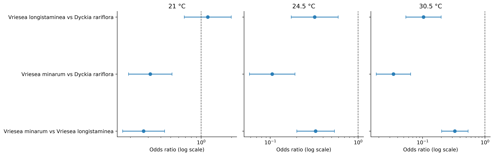

# Bromeliad seed germination: supplementary material

Supplementary material for **Thermal variation reveals contrasting germination patterns among rupestrian grassland bromeliads**, submitted to *Seed Science Research* and presented as Annex D of the doctoral thesis.

This repository preserves the supplementary files prepared for submission. It does not assert acceptance or publication of the manuscript.

## Supplementary files

- [Tables S1–S7 (Excel)](supplementary/SEEDS_SUPLEMENTAR.xlsx)
- [Figure S1 (PDF)](supplementary/FigS1.pdf)
- [Figure S1 (PNG)](supplementary/FigS1.png)
- [Supplementary index](supplementary/README.md)

The workbook contains replicate-level germination traits and cumulative-curve fits (S1), thermal-curve input means (S2), descriptive summaries (S3), final-germination model coefficients (S4), model predictions (S5), extrapolated thermal limits and their interpretation (S6), and operational performance at day 14 (S7).

## Figure S1

Pairwise comparisons of final germination among Dyckia rariflora, Vriesea longistaminea and V. minarum at 21, 24.5 and 30.5 °C. Points show estimated odds ratios and horizontal bars show 95% confidence intervals. The vertical dashed line marks an odds ratio of 1. Axes are logarithmic.

## Scope and provenance

The three supplementary files are unchanged copies of the files supplied in the manuscript submission package. PDF and PNG are alternative formats of the same figure. No statistical analysis was rerun for this deposit. Analysis code and raw experimental records are not included.

For a fixed snapshot, use a commit-specific URL from the repository history.

Repository organization and this README were prepared with assistance from OpenAI Codex. The supplementary files were preserved without modification.
